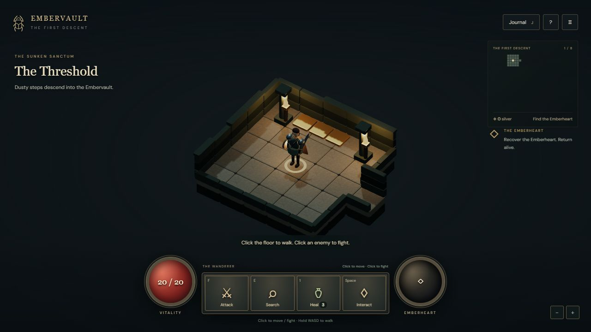

# Embervault — The First Descent

An original mouse-driven dungeon adventure. Explore eight chambers in a buried vault, fight its guardians, recover the Emberheart and return alive. Embervault is a working title.

**[Play Embervault](https://andredp-developer.github.io/embervault/)**

## Play locally

With Node.js 22 or newer, run `npm install` and `npm run dev` in this directory. Open http://127.0.0.1:5180/. `npm run build` creates the static production build in `dist/`. WebGL is required; assets are bundled locally.

- Click ground to walk there, enemies to approach and repeatedly attack, or objects to interact.
- Hold WASD / arrows to walk. F attacks, E searches, 1 / H heals, Space interacts.
- J opens the journal. Escape pauses. Mouse wheel or the zoom buttons adjust the camera.
- Movement and attacks have **no stamina, fatigue or weight costs**. There is no Rest action.
- Healing salves are limited. Enemies act when you do; idle time is safe. Combat remains action-driven, not yet a continuous real-time simulation.
- Find the hidden passage beyond the Hall of Pillars, recover the Emberheart, then click the entrance circle to escape.

## Current scope

Eight authored rooms, six enemies across two types, a hidden passage, a trap, treasure, healing, the Emberheart and escape/death screens. Includes animated articulated characters, bevelled stonework, route previews, target health, damage numbers, a discovery map and a journal. No save/load, audio, equipment selection or character progression yet. Reloading starts over.

The prototype began as an Apshai-inspired experiment and has changed direction into an original game. No original Apshai code, maps or artwork are bundled.

## Validation

`npm test` runs 11 simulation/navigation tests, including unrestricted long-distance movement with heavy loot, explicit enemy selection, pathfinding obstacles, combat, healing, hidden doors, death and a complete normal-enemy expedition without resting.

## Code and licenses

- `src/world.js`: original level and encounter data.
- `src/game.js`: simulation rules.
- `src/navigation.js`: discovery-aware pathfinding.
- `src/scene.js`, `src/character.js`: Three.js environment and articulated characters.
- `src/main.js`, `src/style.css`: mouse/keyboard controls and interface.

Three.js is bundled under MIT (`src/vendor/THREE-LICENSE.txt`), and DM Sans under SIL OFL (`public/fonts/dmsans-OFL.txt`). Geometry and surface textures are generated locally in code.
